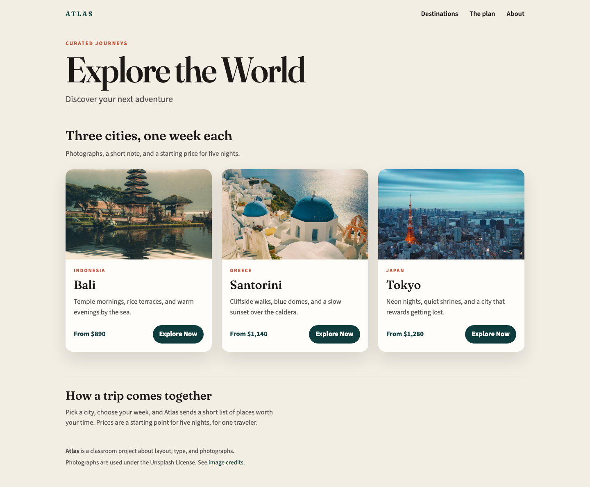

# 11 — Travel Destination Explorer

Part of [01 — CSS fundamentals](../README.md).

## Difficulty

Beginner

## Estimated time

30–40 minutes

## Learning objectives

You practice the flex row from [05 — Flex](../05-flex/README.md) on a real page:

- `display: flex` lays the destination cards out in one row
- `justify-content: space-between` pushes the logo and the navigation apart, and does the same for a price and a button
- `align-items: center` centers items on the cross axis
- `gap` is the space between items, and it does not add space before the first or after the last
- `padding` and `margin` separate the text from the edges
- `border-radius` and `box-shadow` shape the card
- `object-fit: cover` crops a photograph to a frame without stretching it

## Expected result

Open the [finished page](solution/index.html) with Live Server if you want to compare in the browser. Install steps are in [extensions/README.md](../../../extensions/README.md).

## Your mission

Build Atlas, a travel page. The HTML is already written. Bali, Santorini, and Tokyo each have a photograph, a country, a short note, a price, and an Explore Now link. Your stylesheet turns that list into one horizontal row of cards and finishes the navigation bar.

## Tasks

1. Make `.site-header` a flex row. Put the logo and the navigation at opposite ends, and center them vertically.
2. Make `.nav` a flex row with `28px` between the links.
3. Make `.cards` a flex row with `24px` between the three destination cards.
4. Give every destination image the same frame: full card width, `220px` tall, cropped with `object-fit: cover`.
5. Round each card by `18px`, clip the photograph inside that curve, and add a soft shadow.
6. Put the price and the Explore Now link on one row, at opposite ends.

The TODO comments in `style.css` match these tasks.

## Hints

- Flex properties go on the parent. `.cards` is the parent of the three articles. `.card` is a parent of the image and the text, which is a different question.
- `gap: 24` is invalid. The number needs a unit.
- `object-fit` does nothing useful until the image has a width and a height that differ from the photograph’s own shape.
- `overflow: hidden` on `.card` is what cuts the photograph to the rounded corners. Radius on the image alone leaves the card’s corners square.
- The header and the card footer both want `justify-content: space-between` and `align-items: center`.

## Bonus challenge

Let the cards wrap onto another row when the window is narrow. `flex-wrap: wrap` belongs on `.cards`. A `@media (max-width: 800px)` block can also let the header wrap. A media query is a separate stylesheet section that applies only when the condition is true. This course has not graded media queries yet. The bonus is optional.

## How to run

1. Open `index.html` in this folder.
2. Start Live Server. Install steps are in [extensions/README.md](../../../extensions/README.md).
3. Edit `style.css` and save. The browser reloads.
4. Leave `index.html` as it is.

You can also open `index.html` directly in a browser. The photographs are in `assets/images/`, so the page does not need a network connection for the pictures. The typefaces load from Google Fonts when you are online, and fall back to Georgia and a system sans-serif when you are not.

## How to check your work

- The three cities sit side by side on a wide screen, with a gap you can see.
- The logo is on the left of the bar and the links are on the right.
- The photographs are the same height and are not stretched.
- The cards have rounded corners and a shadow.
- The price and the button share one line.
- Nothing spills past the right edge of a phone-width window after the bonus. Before the bonus, a narrow window may still show one stacked column, which is fine.

## Solution

The finished stylesheet and page are in [solution/index.html](solution/index.html). Read it after you have tried the TODOs. Comparing too early skips the layout practice.

`npm test` does not grade this page. Lesson 01 exercises still use the test runner. This one is checked by eye, against the preview and the solution.
