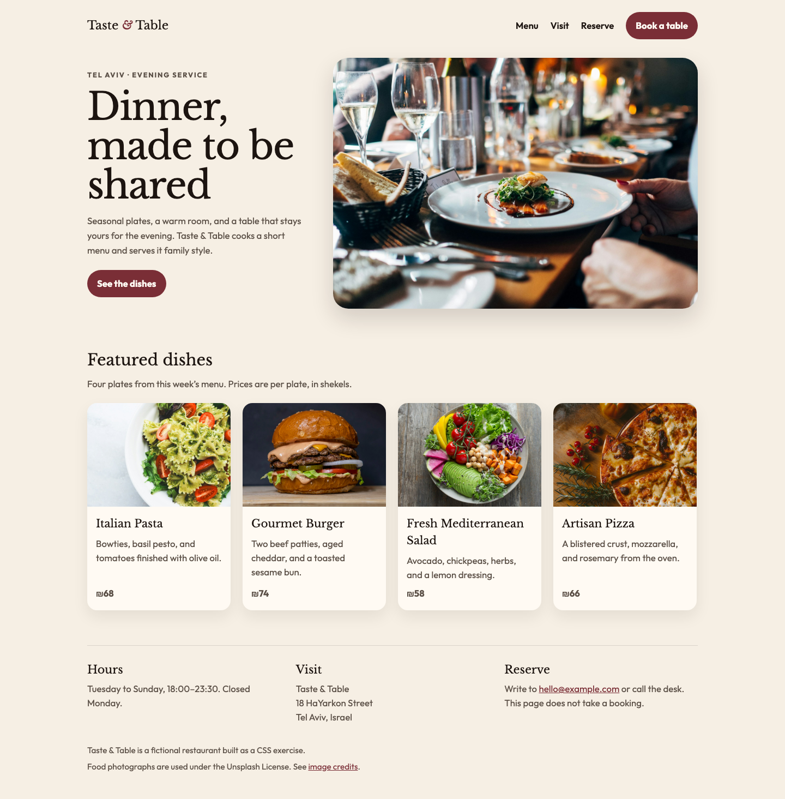

# 14 — Restaurant Landing Page

Part of [01 — CSS fundamentals](../README.md).

## Difficulty

Beginner+

## Estimated time

40–45 minutes

## Learning objectives

One page, several flex containers, each with its own job:

- The header is a row: logo, then navigation, with `justify-content: space-between`
- The hero is a row: text beside a photograph, with `align-items: center`
- The menu is a wrapping row of four dishes
- `flex-direction` flips the hero to a column on a narrow window
- A photograph can be an element with `object-fit`, or you can round it in place
- Type size, line height, padding, and `border-radius` finish the restaurant’s voice

Taste & Table is a fictional restaurant. The address does not take reservations.

## Expected result

Open the [finished page](solution/index.html) with Live Server to compare. Install steps are in [extensions/README.md](../../../extensions/README.md).

## Your mission

The copy and the photographs are in the HTML. You arrange the navigation, place the hero text beside the dining-room photograph, line up the four dishes, and give the buttons and the headline a finished shape.

## Tasks

1. Make the header a flex row with the logo and the nav at opposite ends. Make `.nav` a row with `22px` between the links.
2. Place `.hero-copy` and `.hero-image` side by side, centered, with `48px` between them. Give the photograph a height and `object-fit: cover`, and round it by `28px`.
3. Lay `.menu` out as a wrapping flex row with `22px` between dishes. Round the cards, clip the photos, and give the four images one shared height.
4. Style `.button` as a burgundy pill: white text, no underline, padding, fully rounded corners.
5. Set the size and line height of the `h1`. A size near `clamp(2.6rem, 5vw, 4.3rem)` and a line height near `1.05` match the reference. `clamp(minimum, preferred, maximum)` picks a size that grows with the window and then stops.
6. Give the hero paragraph a line height near `1.6`.

## Hints

- `.nav a:not(.button)` colors the text links. The button is excluded on purpose, so a white button label is not painted back to ink.
- Four dishes with `flex-grow: 1` and no `max-width` can leave the last row with one very wide card. A basis of `calc(25% - 17px)` and the same `max-width` keeps four equal columns. `calc()` does arithmetic inside a property.
- The hero image is a replaced element. `height` and `object-fit: cover` crop it. `width: 100%` alone preserves the photograph’s own ratio and the picture becomes very tall.
- The ampersand in the logo is a `span` so its color and italic style can differ from the words around it.

## Bonus challenge

Make the navigation wrap, and stack the hero, without JavaScript. `flex-wrap: wrap` on `.nav` lets the links drop to the next line. `@media (max-width: 800px) { .hero { flex-direction: column; } }` stacks the photograph under the headline. Nothing on the page needs a script to do that.

## How to run

1. Open `index.html` in this folder.
2. Start Live Server. Install steps are in [extensions/README.md](../../../extensions/README.md).
3. Edit `style.css` and save. Leave `index.html` as it is.

## How to check your work

- The logo is on the left and Book a table reads as a button.
- On a wide window the headline and the dining-room photograph share a row.
- Pasta, the burger, the salad, and the pizza share a row, with equal image heights and rounded corners.
- The headline is large and the paragraph under it is comfortable to read.
- Hours, the address, and the reserve note are on the page.
- A narrow window does not scroll sideways. The bonus stacks the hero.

## Solution

[solution/index.html](solution/index.html) is the finished page.

`npm test` does not grade this exercise.
