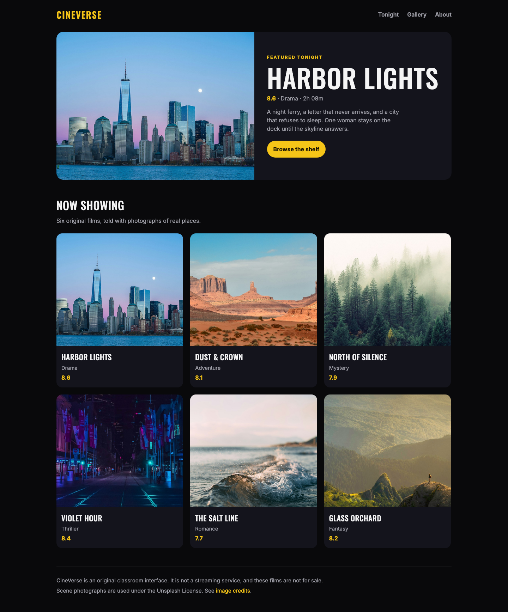

# 07 — Movie Streaming Gallery

Part of [Visual CSS Challenges](../README.md).

## Difficulty

Beginner

## Estimated time

35–45 minutes

## Learning objectives

- `display: flex` and `flex-wrap: wrap` build a shelf that continues onto the next row
- `gap`, `justify-content`, and `align-items` control the shelf
- `background-color` and `color` keep the dark theme readable
- `border-radius` and `overflow: hidden` shape a poster
- `transition` and `transform` animate a hover

The film titles are original. The pictures are places, not studio posters. The brand on this page is CineVerse.

## Expected result

Open the [finished page](solution/index.html) with Live Server to compare. Install steps are in [extensions/README.md](../../../extensions/README.md).

## Your mission

The featured film, Harbor Lights, is already a flex row. Read that rule, then build the shelf under Now showing. Six posters should share rows, keep the same image size, and grow slightly when the pointer is over them.

## Tasks

1. Make `.posters` a wrapping flex row with a `20px` gap.
2. Give each `.poster` a dark panel, `16px` corners, and a basis near `180px` so several fit on a line.
3. Make every poster image `320px` tall, full width, and cropped with `object-fit: cover`.
4. Stack the title, genre, and rating, and paint the rating with the gold color already in `:root`.
5. On hover, scale the poster to `1.04`. Transition `transform` for about `0.25s`.

## Hints

- The featured row is a finished example. The properties you need are already written on `.feature`. Copy the idea, not the pixel sizes.
- `flex-wrap: wrap` is what starts a new row. Without it, flex items stay on one line and shrink.
- If the last poster stretches across the whole page, it is growing. Set `max-width`, or set `flex-grow` to `0`.
- `overflow: hidden` on the poster clips the image to the rounded corners. It does not block `transform` on the poster itself.
- `transform: scale(1.04)` needs a `transition` on `transform` if the change should ease in. A change with no transition snaps.

## Bonus challenge

The scale is the bonus. After it works, add a `@media (prefers-reduced-motion: reduce)` block that removes the transition. Some people get sick from motion, and this query lets them turn it off in their system settings.

## How to run

1. Open `index.html` in this folder.
2. Start Live Server. Install steps are in [extensions/README.md](../../../extensions/README.md).
3. Edit `style.css` and save. Leave `index.html` as it is.

The photographs load from `assets/images/`. Oswald and Inter load from Google Fonts when you are online.

## How to check your work

- The page background stays near black and the text stays light.
- Harbor Lights is a wide feature with the photograph beside the title.
- Six posters form rows, with an even gap, and the images share one height.
- Ratings are gold. Genres are quieter than the titles.
- Hovering a poster enlarges it smoothly.
- A narrow window does not grow a sideways scrollbar. The feature stacks because that rule is already in the stylesheet.

## Solution

[solution/index.html](solution/index.html) is the finished page. Use it after your own attempt.

`npm test` does not grade this exercise.
