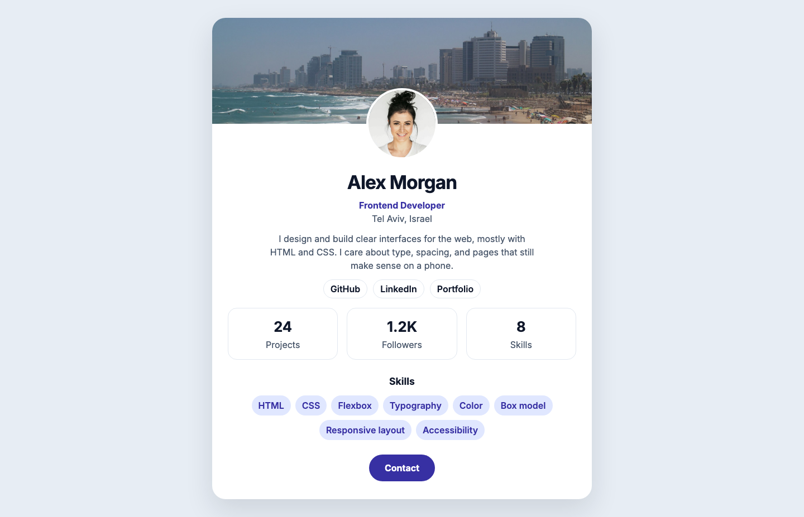

# 08 — Professional Profile Dashboard

Part of [Visual CSS Challenges](../README.md).

## Difficulty

Beginner+

## Estimated time

35–45 minutes

## Learning objectives

This page nests flex containers. A container can also be an item of the container outside it.

- The page centers one card: `justify-content` and `align-items` on a row, with `min-height: 100vh`
- The card itself is a column: `flex-direction: column` and `align-items: center`
- The statistics are a row inside that column
- The skills are another row, with `flex-wrap`
- `gap` replaces a pile of margins between siblings
- `border`, `border-radius`, and `box-shadow` are already started on the card. You finish the portrait and the button.

`vh` means a percentage of the viewport height. `100vh` is the height of the browser window.

## Expected result

Open the [finished page](solution/index.html) with Live Server to compare. Install steps are in [extensions/README.md](../../../extensions/README.md).

## Your mission

Build a profile for Alex Morgan, a frontend developer in Tel Aviv. The banner, the type, and the card surface are started. You center the card, turn the portrait into a circle, line up the three statistics, and lay the skills out as badges.

The portrait is a stock photograph. The name is fictional.

## Tasks

1. Center `.profile` in `.page`, horizontally and vertically. The page should be at least as tall as the window.
2. Make `.profile` a column and center its children on the cross axis. Keep the banner full width. A centered column shrinks a child unless that child has `width: 100%` or `align-self: stretch`.
3. Make `.avatar` a circle: `border-radius: 50%`, `object-fit: cover`, a white border, and a negative top margin so the portrait sits on the banner.
4. Lay `.stats` out in one row with `16px` between the three numbers. Let each stat grow.
5. Lay `.badges` out in a wrapping row, centered, with `8px` between badges.
6. Style the contact link as an indigo pill with white text.

## Hints

- The social links are already a small flex row. The statistics and the badges want the same kind of parent.
- `justify-content` moves items along the row. `align-items` moves them across the row. In a column, those axes swap.
- `border-radius: 50%` on a square box makes a circle. If the box is not square, it makes an oval.
- A negative margin pulls an element toward its previous sibling. `margin-top: -64px` is half of the 128px portrait, so the circle straddles the banner.
- The banner photograph is Tel Aviv. Credit is in [assets/images/credits.md](assets/images/credits.md).

## Bonus challenge

Under `560px`, stack the statistics vertically with `flex-direction: column` inside `@media (max-width: 560px)`. The row of three numbers gets cramped on a phone. A column gives each number the width of the card.

## How to run

1. Open `index.html` in this folder.
2. Start Live Server. Install steps are in [extensions/README.md](../../../extensions/README.md).
3. Edit `style.css` and save. Leave `index.html` as it is.

## How to check your work

- The card sits in the middle of the window, not stuck to the top left.
- The portrait is a circle and overlaps the banner.
- 24, 1.2K, and 8 share one row.
- The eight skills are pills on one or two lines, not a vertical list with bullets.
- The contact link looks like a button.
- On a narrow window the card stays inside the screen. The bonus stacks the statistics.

## Solution

[solution/index.html](solution/index.html) is the finished page.

`npm test` does not grade this exercise.
