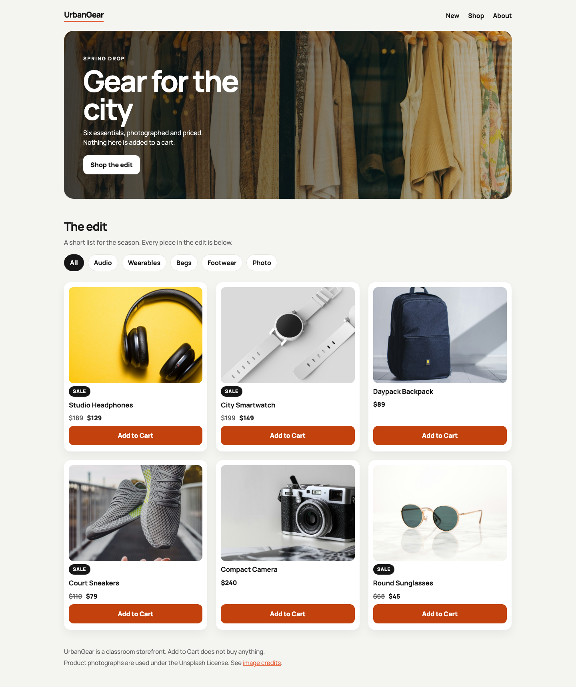

# 10 — Modern E-Commerce Store

Part of [Visual CSS Challenges](../README.md).

## Difficulty

Beginner+

## Estimated time

40–45 minutes

## Learning objectives

UrbanGear is the page that uses the whole flex toolkit from the earlier challenges:

- `display: flex` and `flex-wrap` build the product gallery
- `justify-content`, `align-items`, and `gap` space the cards
- `flex` sets grow, shrink, and basis in one declaration
- `width`, `max-width`, and `object-fit` keep photographs consistent
- `border-radius` and `box-shadow` are already started on the card
- A sale badge and a button are ordinary elements inside the column, not a second layout system

Add to Cart does not buy anything. The category links do not filter the grid. Both are visual.

## Expected result

Open the [finished page](solution/index.html) with Live Server to compare. Install steps are in [extensions/README.md](../../../extensions/README.md).

## Your mission

The banner and the category pills are finished flex rows. The six products are still a list. Turn them into a responsive gallery: headphones, a smartwatch, a backpack, sneakers, a camera, and sunglasses. Four of them are on sale.

## Tasks

1. Make `.products` a wrapping flex row with a `22px` gap.
2. Give every product image the same frame: full width, `240px` tall, `object-fit: cover`, `12px` corners.
3. Make each `.product` a column with a small gap. `flex: 1 1 260px` lets the cards share the row and wrap. `margin-top: auto` on the button uses leftover space in that column and lines the buttons up.
4. Style `.badge` as a small black pill. `align-self: flex-start` keeps it as wide as the word Sale.
5. Style `.button` as a full-width accent button with white text. Style `.button-light` for the banner, with a white background and dark text.
6. Keep the gallery inside the screen on a narrow window. A `max-width` on `.product`, or a media query that sets `flex-basis: 100%`, does that.

## Hints

- `.filters` is a finished wrapping row. The product list wants the same shape, with larger items.
- The banner’s photograph is a CSS background, layered under a dark gradient so the white headline stays readable. The product pictures are `img` elements. Both are on the page so you can compare them.
- `flex: 1 1 260px` means grow, shrink, and a basis of 260px. Six cards with `flex-grow: 1` can leave two stretched cards on the last row. `max-width: calc(33.333% - 15px)` locks three equal columns. The solution uses that.
- Sale is a paragraph in the HTML, not a sticker that requires `position`. You do not need positioning for this exercise.
- White text on a bright orange is hard to read. The reference button uses `#c2410c` for the fill and white for the label. `#e4572e` stays on the logo underline, where it is a stripe rather than a text background.

## Bonus challenge

On hover, move a product card up by `4px` with `transform: translateY(-4px)` and deepen the shadow. Transition `transform` and `box-shadow`. Darken the button on hover with a different background. Skip the motion inside `@media (prefers-reduced-motion: reduce)`.

## How to run

1. Open `index.html` in this folder.
2. Start Live Server. Install steps are in [extensions/README.md](../../../extensions/README.md).
3. Edit `style.css` and save. Leave `index.html` as it is.

The banner image is referenced from `style.css`. If that path breaks, the headline sits on a flat color. The product `src` paths are in the HTML and should not be edited.

## How to check your work

- The banner shows the clothing-rack photograph with a dark fade behind the headline.
- Category pills sit in a row. All is filled in.
- Six products form even columns, with photographs of one height.
- Sale appears on the headphones, the watch, the sneakers, and the sunglasses.
- Add to Cart looks like a button and does not navigate to a checkout.
- At a phone width the cards stack or sit two-up, and the page does not scroll sideways.

## Solution

[solution/index.html](solution/index.html) is the finished page. Its stylesheet points at `../assets/images/` because it lives one folder down.

`npm test` does not grade this exercise.
